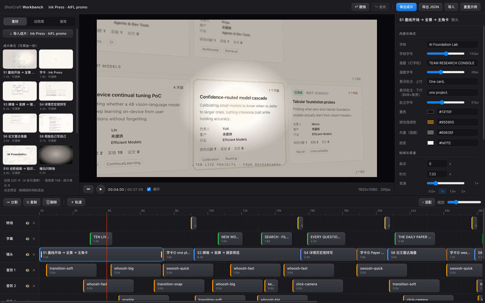
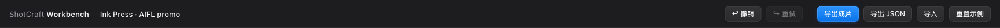
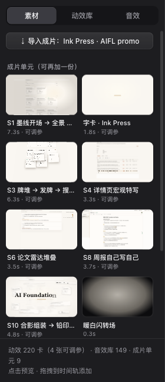
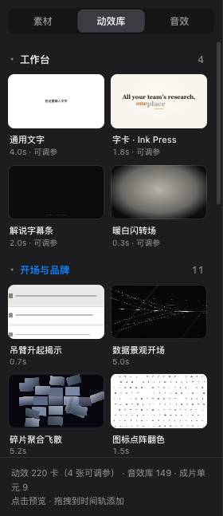
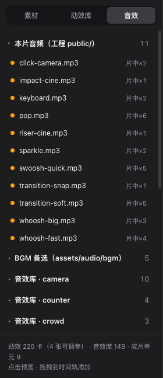
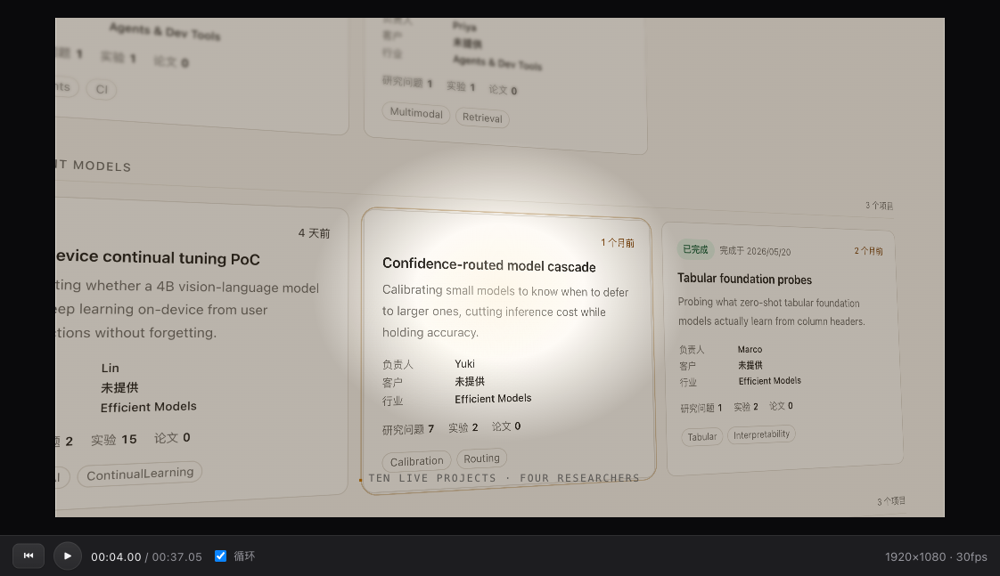
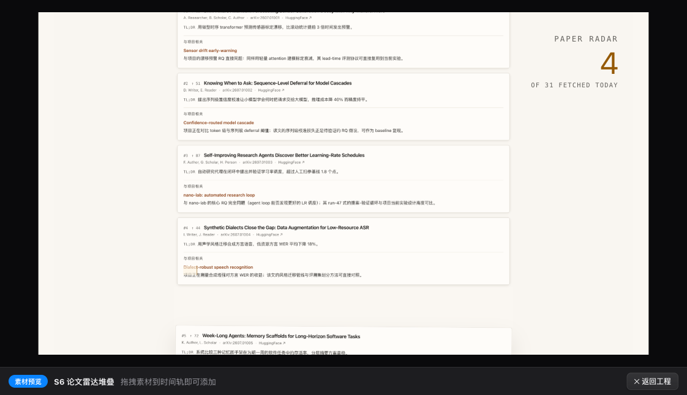
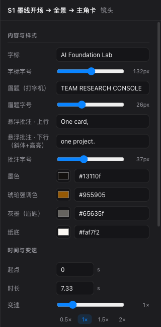
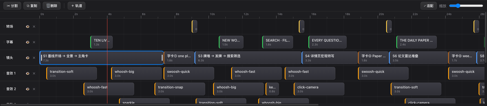

# Motion Workbench · User Guide

Fine-tune delivered videos in your browser: reposition shots, adjust playback speeds, edit copy, recolor scenes, insert new motion cards, add sound effects, and export the finished MP4 with a single click.
This guide walks through each interface area. For developer contracts and specs, refer to [references/workbench.md](../references/workbench.md); for technical architecture, see [workbench/README.md](README.md).

## How to Launch

The skill automatically runs this command upon delivery and opens your browser; you can also launch it manually anytime:

```bash
node workbench/scripts/open.mjs <project_dir>     # Automatically installs dependencies on first run
```

- Accessible at `http://localhost:5198/`; opening with `?import=project` automatically splits the video into multi-track clips per project manifest.
- Reopening the same project preserves previous modifications; the workbench re-imports only if code changes (manifest hash mismatch), pushing previous states to the undo stack (accessible via Cmd+Z).
- All changes save automatically to local browser storage (`localStorage`). To stop the server: `kill $(cat workbench/.dev.pid)`.

## Interface Overview



Five core panels from left to right, top to bottom:

| Panel | Position | Purpose |
|---|---|---|
| Top Bar | Top | Project title, Undo / Redo, Export MP4, Export / Import JSON, Reset Demo |
| Library | Left | Project clips, assets, 150 motion demo cards, SFX and BGM; click to preview, drag to timeline |
| Preview | Center | Remotion Player live composition with playback controls |
| Inspector | Right | Selected clip's copy, typography, color palettes, timing, speed, and transform properties |
| Timeline | Bottom | Multi-track timeline: arrange, trim, split, duplicate, retime, and layer clips |

All three divider handles can be dragged to resize panels; dimensions are persisted.

## Top Bar



- **Project Title**: Click directly to edit; sets exported MP4 and JSON filenames.
- **Undo / Redo** (Cmd+Z / Shift+Cmd+Z): One step per edit gesture; rapid inputs on the same control within 0.8s merge into a single step.
- **Export Video**: Dispatches the project to the dev server to render via Remotion, displaying export progress percentage on the button. Upon completion, click "✓ Exported · Show file" to locate the MP4 in Finder (`workbench/exports/`). Export duration matches the end of the latest clip.
- **Export / Import JSON**: Project state is portable JSON — save backups, share with team members, or paste into Remotion Studio's Props panel.
- **Reset Demo**: Reverts to the built-in demo project (undoable).

## Asset Library

Three tabs where **Click = Preview in Center, Drag to Timeline = Add Clip**.

### Project Assets



- **Import Project**: Re-parses and decomposes project from `src/workbench.ts` manifest (undoable).
- **Project Units**: Every scene, title card, subtitle strip, and transition exists as an editable card labeled with duration and parameter status. Drag duplicates onto tracks as needed.
- **Media Files**: Images and videos from project `public/`, grouped by folder.

### Motion Cards



- Built-in "Workbench" group features 4 native parameterized cards: Generic Text, Ink Press Title Card, Subtitle Strip, and Warm White Flash Transition.
- 150 categorized demo cards (Opening & Brand, Typography, Data & Metrics, etc.). Thumbnails are frozen keyframes; **hover over a card to loop preview**.
- Badges show card duration; parameterized cards expose content and style controls in the inspector. All cards support trimming, speed retiming, freezing, and layer transforms once placed on tracks.

### Audio



- **Project Audio**: Sound effects from project `public/`; right badge indicates usage count in original render.
- **BGM Candidates & SFX Library**: 149 audio assets categorized from repository `assets/audio/`.
- Audio clips on tracks support in-point trimming, playbackRate adjustment, and volume control without muting.

## Preview & Transport Controls



- Center Remotion Player matches final render frame-for-frame; editing inspector values or moving clips updates preview instantly.
- Transport Bar: Jump to start, Play / Pause (Space), Timecode (seconds.frames / total), Loop toggle, resolution and frame rate.
- Click the video directly to Play / Pause; Left / Right arrows step frame-by-frame (hold Shift for 10-frame jumps).
- Clicking any item in the library enters **Card Preview** mode, looping that card in isolation; click "Back to Project" to return to timeline preview:



## Inspector Panel



Selecting a clip on the timeline populates the right panel across three sections:

- **Content & Style**: Auto-generated from component schemas — text, textareas, sliders, color pickers, dropdowns, toggles. Exposes contextual parameters (wordmarks, headlines, notes, colors, materials) while locking motion invariants (durations, easing curves, camera moves) to prevent degradation.
- **Timing & Speed**: Start frame, duration (seconds), speed slider with 0.5× / 1× / 1.5× / 2× presets, in-point trimming, and "↺ Restore Original Duration". Displays a warning notice if card FPS diverges from project FPS.
- **Layer**: Opacity, scale, translation X / Y.

Bottom "Delete Clip" button mirrors the Delete key.

## Timeline



- **Toolbar**: Split (S, cuts selected clip at playhead), Duplicate (Cmd+D), Delete, + Track (adds layer to top), Fit to view, Zoom slider.
- **Track Headers**: Drag handle to reorder layer hierarchy (upper tracks overlay lower tracks); Eye toggle hides / reveals track; × deletes track. Imported tracks mirror original composition z-order: Transitions > Subtitles > Overlays > Scenes > BGM > SFX.
- **Clips**: Drag clip body to reposition (snapping to adjacent clip edges); drag between tracks; drag edge handles to trim in/out points. Badges indicate duration, speed factor, in-point offset, and opacity.
- **Ruler**: Click or scrub ruler to jump playhead; red line denotes current playhead.
- Clips may overlap on the same track (represented across multi-track hierarchy).

## Keyboard Shortcuts

| Shortcut | Action |
|---|---|
| Space | Play / Pause |
| Left / Right Arrow | Step frame-by-frame (hold Shift for 10 frames) |
| S | Split selected clip at playhead |
| Cmd+D | Duplicate selected clip |
| Delete / Backspace | Delete selected clip |
| Cmd+Z / Shift+Cmd+Z | Undo / Redo |

## Example Editing Workflow

1. Workbench launches automatically after delivery, with the project decomposed across tracks.
2. Click "S1 Ink Line Open" on the timeline; in the right inspector, update "Wordmark" to your new brand name and enlarge "Wordmark Size" — preview updates immediately.
3. Subtitle appearing too early? Drag the caption clip to shift it right; want a shot to linger longer? Adjust speed slider to 0.8×.
4. Drag "Dataviz Landscape Open" from Motion Cards to the top track as an intro, then drag a whoosh sound effect to align with its start.
5. Click "Export Video", wait for render completion, then click "Show File" to grab your MP4.

## Advanced Usage

- Make custom project scenes editable: expose contextual parameters as defaulted props + schema in `src/workbench.ts` ([references/workbench.md](../references/workbench.md) §2–§3).
- Parity verification: `cd workbench && npm run parity` diffs imported playback against the original render frame-by-frame.
- Remotion Studio view: `cd workbench && npm run studio` mounts dedicated compositions per card with official Inspector integration.
